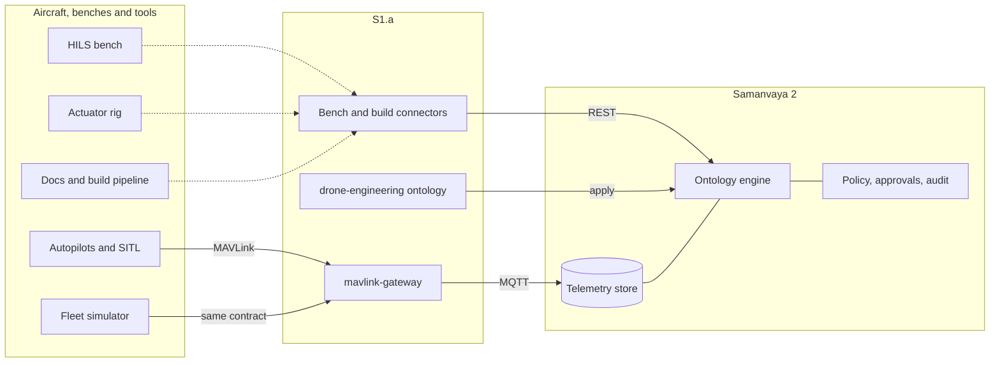

# S1.a — Samanvaya 1

**One record of what a drone company required, built, tested and flew.**

S1.a connects a commercial drone fleet and its engineering tools to
[Samanvaya 2 (S2)](https://github.com/veerendra-saraswathi/S2), an open-source data
platform. Live telemetry from the aircraft, results from the test benches and artifacts
from the software pipeline all land in one model, where they can be queried, acted on
under policy, and audited. Civilian use only.

## The problem

A drone company runs many tools that do not talk to each other. The autopilot speaks
MAVLink. The hardware-in-the-loop bench writes its own logs. Requirements live in
documents, builds in CI, simulation results in another application. Nothing holds an
identifier the others recognise, so no query spans them.

When a customer, an insurer or a regulator asks "which requirement does this build
satisfy, how was it tested, and who cleared it to fly?", the answer is assembled by
hand, by whichever engineer remembers where things live.

S1.a makes that answer a query.

## What it does



Solid lines are built and have been run against a live engine. Dotted lines wait on a
bench, a rig or a pipeline that does not exist yet — not on S1.a.

1. **Carries live telemetry into S2.** A small Go service listens for MAVLink from
   autopilots or simulators and republishes position, battery, attitude and GPS health
   in S2's telemetry contract. It is receive-only: it opens no path back to the vehicle,
   so nothing in a control loop can wait on it.
2. **Models the engineering record.** An S2 ontology pack defines requirements,
   documents, software builds, test runs, anomalies and subsystems, and the links
   between them. Because the links close a loop, questions become graph walks.
3. **Takes in what the benches and the pipeline produce.** Two connectors read a
   published contract and write it as objects, links and governed actions.
4. **Puts the decisions that matter behind approval.** Baselining a document may be
   proposed by an AI agent and must be approved by a person. Clearing a build for flight
   needs a second person and is closed to agents entirely. Every request, approval and
   refusal lands in a tamper-evident log.
5. **Makes a build earn its clearance.** A build moves from built, to simulation passed,
   to bench passed, one step at a time, each step taken when a run passes and naming
   that run. Clearance for flight cannot even be requested for a build that has not
   passed the bench: the policy refuses it and says why.

## Where it sits

Samanvaya is three layers over one shared ontology. **0.5** operates a mixed fleet from
a single screen. **1** — this repository — records what was required, built, tested and
flown. **2** scales that record into an enterprise data platform. The same object and
link types are defined once and used by all three, which is what lets a question cross
them.

## Progress against the module specifications

Project Samanvaya specifies six product modules. S1.a implements none of them; it is the
layer that lets them share one record. What follows is what each module can already
write, and what it is still waiting for.

| Module | What it produces | What S1.a carries today | Still needed |
|---|---|---|---|
| **M1** GNSS-denied night navigation | Flight datasets, position estimates, flight trial results | Position and attitude reach S2 through the gateway; `TestRun` of kind `FLIGHT` models a trial | Datasets and trained models are not modelled; nothing runs on the Jetson yet |
| **M2** HILS anomaly detection | Verdicts, anomaly windows, root-cause attributions | All three, through the bench connector: `recordTestVerdict`, `raiseAnomaly` carrying `detectedAt` and `durationS`, and `attributeAnomaly` | A bench that writes `s2.bench-report/v1`; source timestamps for millisecond alignment |
| **M3** Generated aviation documents | Requirements and documents with traceability | `Requirement` and `EngineeringDocument` across the SYSRS, IRS, MOM, SRS, SDD, ICD, STP and STR kinds, and `baselineDocument` — proposable by an agent, approved by a person | A generator that writes the documents and requests the baseline |
| **M4** Offline agentic engineering platform | Source, builds, unit and SITL test reports | Everything but the source, through the build connector: `SoftwareBuild` with its commit and artifact digest, `implements` links, and unit and SITL runs closed with verdicts | A pipeline that emits `s2.build-record/v1`; S2's offline install path is untested |
| **M5** Multi-drone GIS simulator | Simulated missions and telemetry | Simulated telemetry enters on the same contract as an aircraft, which `tools/mavlink-sim` demonstrates; `TestRun` of kind `SIMULATION` | Scenarios and GIS terrain are not modelled |
| **M6** Actuator visual twin | Fault classifications | The `Anomaly` fault taxonomy is M6's — reduced gain, binding, frequency shift, increased damping, timing drift — with `VISUAL_TWIN` as a detector | A CAN gateway for the rig's bus; a twin that writes classifications |

**Two of the six have a built and verified path into the record.** The other four have
their object types, link types and actions defined and are waiting on the module itself.

## Status

| Component | Path | State |
|---|---|---|
| MAVLink gateway | `gateways/mavlink-gateway` | Built. Parser tested against pymavlink; output validated against S2's contract code; MQTT tested against a broker, including reconnect |
| Drone engineering ontology | `ontologies/drone-engineering` | 6 object types, 9 link types and 7 actions. Version 0.2.0 was applied to a live S2 engine; 0.3.0, which adds the build gate, has not been yet |
| HILS bench connector | `connectors` | Built. Bench report contract v1, and a report written into a live engine end to end |
| Build provenance connector | `connectors` | Built. Build record contract v1, and a record written into a live engine end to end |
| Build gate | `policies`, `connectors` | Built. `advanceBuild` and its policy; both connectors ask for the step a passed run earns. Policy tested under OPA, connectors against a stubbed engine. Not yet run against a live engine |
| Worked example | `tools/seed-chain` | Ran end to end against a live engine at pack 0.2.0, and is safe to re-run. Not re-run since the gate changed it |
| MAVLink simulator | `tools/mavlink-sim` | Built |
| CAN and simulator connectors | | Planned |

## What has been verified

| Claim | How it was checked |
|---|---|
| The parser decodes MAVLink correctly | Frames for every decoded message, encoded by pymavlink in v1 and v2, compared field by field |
| It survives fragmentation, noise and corruption | A multi-frame stream fed one byte at a time with leading garbage; a flipped payload byte |
| Output conforms to S2's telemetry contract | Gateway output from a simulated three-drone run passed through S2's own validator |
| The pack applies to a live engine | Applied to a running stack; object, link and action types registered |
| The worked example runs end to end | At pack 0.2.0: 26 requests against a live engine, with both approval gates held awaiting a second person |
| A bench report becomes a test run | Submitted live: the run created and linked, two anomalies raised with their windows, one attributed, the verdict recorded |
| A build record becomes a build | Submitted live: the build created, its metadata refreshed, one requirement implemented, unit and SITL runs closed `PASS` |
| Re-submission changes nothing twice | Second submissions of both documents: duplicates refused, approval requests replayed, no build dragged backwards |
| The gate's policy allows only the next step | 21 policy tests under OPA 1.20.2 with S2's baseline rules: every out-of-order step, every status but `BENCH_PASSED` at clearance, a late approval of a rejected build, missing input |
| The connectors ask for the right step | Tests against a stubbed engine: a passed SITL run asks for `SIM_PASSED`, a passed HILS run for `BENCH_PASSED`, a record with any failure asks for nothing, and a refusal is reported without failing the submission |

**Not verified:** the build gate against a live engine, and the worked example since the
gate changed it (27 requests now, one approval held and one clearance refused); any run
against a real autopilot or SITL; throughput, latency or resource use; behaviour on a
lossy link. [The technical paper](docs/technical-paper.md)
§6 is the full table and §7 the open questions.

## Tech stack

| Part | Technology | Why |
|---|---|---|
| Gateway | Go 1.22, standard library only | One static binary. No module downloads, so it builds on an air-gapped host |
| Field protocols | MAVLink v1 and v2, MQTT 3.1.1 at QoS 0, JSON | What autopilots speak and what S2's ingestion contract expects |
| Ontology | YAML pack, JSON Schema 2020-12 | Object, link and action types as reviewable code |
| Policy | Rego, served by S2's Open Policy Agent | Whether a build may take a step is a rule about the state of the world, which is what S2 gives a policy and not an action |
| Connectors | Python 3.13, httpx, jsonschema, uv | Off the telemetry path, where a verdict must not be lost but a second does not matter |
| Platform | S2: PostgreSQL with PostGIS, TimescaleDB, Kafka, Mosquitto, OPA, Keycloak | Supplied by S2, not deployed from this repository |

Every choice, including the ones still open, is argued in [the tech stack
document](docs/tech-stack.md).

## Quick start

Needs Go 1.22 or later and [uv](https://docs.astral.sh/uv/).

```bash
make test
make run-dry
make sim
```

`make run-dry` prints what the gateway would publish and connects to nothing; run
`make sim` beside it to feed three simulated drones in.

With an S2 stack running locally (`make up` in the S2 repo):

```bash
make seed
make run
make submit-bench
make gate
```

`make seed` first copies the build gate's policy into the S2 checkout it expects beside
this one (`S2_DIR=../S2`), where S2's OPA picks it up. `make gate` then walks build
2026.11.4 through: recorded, simulation passed, bench passed.

Stop S2's own telemetry simulator first, or both will write to the same drones. `make
help` lists every target. Gateway flags, published metrics and known limits are in the
[gateway README](gateways/mavlink-gateway/README.md).

## Documentation

| Document | Read it for |
|---|---|
| [Architecture](docs/architecture.md) | Components, data flows, the ontology, and what runs where |
| [Technical paper](docs/technical-paper.md) | The design argument, how it was verified, and what is open |
| [Tech stack](docs/tech-stack.md) | Every technology in use or planned, and why it was chosen |
| [Connectors](connectors/README.md) | Both contracts, what a document becomes in S2, and where the connectors are thin |
| [Gateway](gateways/mavlink-gateway/README.md) | Flags, published metrics, and the parser's limits |

## Scope

S1.a holds the integration code and the generic model. It does not hold flight software,
customer telemetry or trained models, which are the operator's. It implements none of
the six modules. The boundary between this public pack and a private, airframe-specific
overlay is not yet drawn, and is tracked in the technical paper's open questions.
