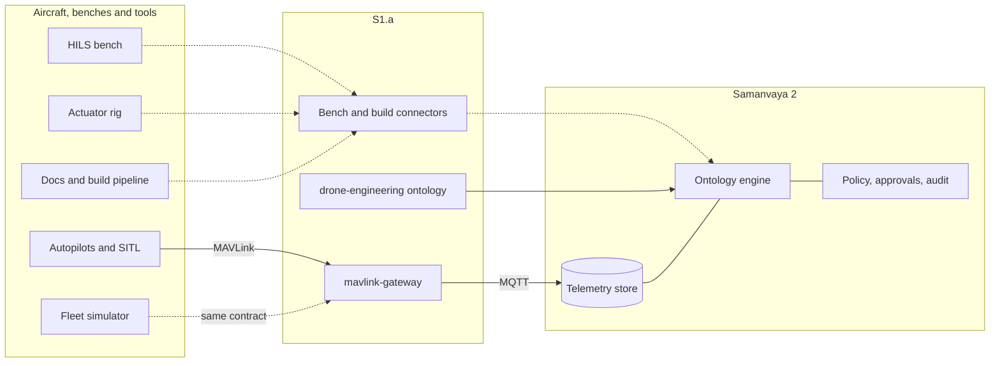

# S1.a

**One record of what a drone company required, built, tested and flew.**

S1.a connects a commercial drone fleet and its engineering tools to [Samanvaya 2 (S2)](https://github.com/veerendra-saraswathi/S2), an open-source data platform. Live telemetry from the aircraft, results from the test benches and artifacts from the software pipeline all land in one model, where they can be queried, acted on under policy, and audited.

## The problem

A drone company runs many tools that do not talk to each other. The autopilot speaks MAVLink. The hardware-in-the-loop bench writes its own logs. Requirements live in documents, builds in CI, simulation results in another application. When a regulator or a customer asks "which requirement does this build satisfy, how was it tested, and who cleared it to fly?", the answer is assembled by hand.

S1.a makes that answer a query.

## What it does



Solid lines are built. Dotted lines are planned.

1. **Carries live telemetry into S2.** A small Go service listens for MAVLink from autopilots or simulators and republishes position, battery, attitude and GPS health in S2's telemetry contract. Each drone's readings attach to its object in S2.
2. **Models the engineering record.** An S2 ontology pack defines requirements, documents, software builds, test runs, anomalies and subsystems, and the links between them.
3. **Puts the decisions that matter behind approval.** Baselining a document can be proposed by an AI agent but needs a person to approve. Clearing a build for flight needs a second person and cannot be proposed by an agent. S2 records every request, approval and refusal in a tamper-evident log.

## Status

This is an early increment. The table says exactly what works today.

| Component | Path | State |
|---|---|---|
| MAVLink gateway | `gateways/mavlink-gateway` | Built. Parser tested against pymavlink; output validated against S2's contract code; MQTT tested against a broker, including reconnect. |
| Drone engineering ontology | `ontologies/drone-engineering` | Applied to a live S2 engine: 6 object types, 9 link types and 6 actions registered. |
| Worked example | `tools/seed-chain` | Runs end to end against a live engine, and is safe to re-run. |
| MAVLink simulator | `tools/mavlink-sim` | Built. |
| HILS bench connector | `connectors` | Built. Bench report contract v1, and a report written into a live engine end to end. |
| Build provenance connector | `connectors` | Built. Build record contract v1, and a record written into a live engine end to end. |
| CAN and simulator connectors | | Planned. |
| Workflow orchestration of the build gate | | Planned. |

## Quick start

Needs Go 1.22 or later and [uv](https://docs.astral.sh/uv/).

```bash
make test        # parser and mapping tests
make run-dry     # terminal 1: the gateway prints what it would publish
make sim         # terminal 2: three simulated drones
```

With an S2 stack running locally and seeded (`make up` and `make seed` in the S2 repo):

```bash
make run         # publish telemetry for DRN-0001..3 to the S2 broker
make seed        # apply the ontology pack and load the worked example
make submit-bench  # write a HILS bench run into S2 from a bench report
make submit-build  # write a CI build and its unit and SITL runs into S2
```

Stop S2's own telemetry simulator first, or both will write to the same drones. Gateway flags, published metrics and known limits are in the [gateway README](gateways/mavlink-gateway/README.md).

## Documentation

| Document | Read it for |
|---|---|
| [Architecture](docs/architecture.md) | Components, data flows, the ontology, and what runs where |
| [Technical paper](docs/technical-paper.md) | The design argument: why the system is shaped this way, how it was verified, what is open |
| [Tech stack](docs/tech-stack.md) | Every technology in use or planned, and why it was chosen |
| [Connectors](connectors/README.md) | Both contracts, what a document becomes in S2, and where the connectors are thin |

## Background

S1.a is part of Project Samanvaya, which covers six product modules for a commercial drone company: night navigation without GNSS, anomaly detection on hardware-in-the-loop benches, generated aviation software documents, an offline agentic engineering platform, a multi-drone simulator, and a visual twin for actuator fault detection. This repository does not implement those modules. It is the layer that lets them share one record. Civilian use only.
