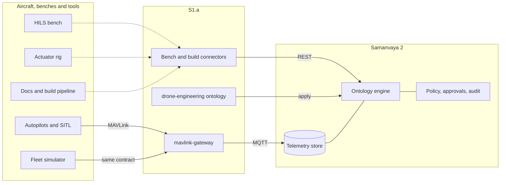

# S1.a — Samanvaya 1

**One record of what a drone company required, built, tested and flew.**

S1.a connects a commercial drone fleet and its engineering tools to
[Samanvaya 2 (S2)](https://github.com/veerendra-saraswathi/S2), an open-source data
platform. Live telemetry from the aircraft, results from the test benches and artifacts
from the software pipeline all land in one model, where they can be queried, acted on
under policy, and audited. Civilian use only.

## The problem

A drone company runs many tools that do not talk to each other. The autopilot speaks
MAVLink. The hardware-in-the-loop bench writes its own logs. Requirements live in
documents, builds in CI, simulation results in another application. Nothing holds an
identifier the others recognise, so no query spans them.

When a customer, an insurer or a regulator asks "which requirement does this build
satisfy, how was it tested, and who cleared it to fly?", the answer is assembled by
hand, by whichever engineer remembers where things live.

S1.a makes that answer a query.

## What it does



Solid lines are built and have been run against a live engine. Dotted lines wait on a
bench, a rig or a pipeline that does not exist yet — not on S1.a.

1. **Carries live telemetry into S2.** A small Go service listens for MAVLink from
   autopilots or simulators and republishes position, battery, attitude and GPS health
   in S2's telemetry contract. It is receive-only: it opens no path back to the vehicle,
   so nothing in a control loop can wait on it.
2. **Models the engineering record.** An S2 ontology pack defines requirements,
   documents, software builds, test runs, anomalies and subsystems, and the links
   between them. Because the links close a loop, questions become graph walks.
3. **Takes in what the benches and the pipeline produce.** Two connectors read a
   published contract and write it as objects, links and governed actions.
4. **Puts the decisions that matter behind approval.** Baselining a document may be
   proposed by an AI agent and must be approved by a person. Clearing a build for flight
   needs a second person and is closed to agents entirely. Every request, approval and
   refusal lands in a tamper-evident log.
5. **Makes a build earn its clearance.** A build moves from built, to simulation passed,
   to bench passed, one step at a time, each step taken when a run passes and naming
   that run. Clearance for flight cannot even be requested for a build that has not
   passed the bench: the policy refuses it and says why.

## Where it sits

Samanvaya is three layers over one shared ontology. **0.5** operates a mixed fleet from
a single screen. **1** — this repository — records what was required, built, tested and
flown. **2** scales that record into an enterprise data platform. The same object and
link types are defined once and used by all three, which is what lets a question cross
them.

## Progress against the module specifications

Project Samanvaya specifies six product modules. S1.a implements none of them; it is the
layer that lets them share one record. What follows is what each module can already
write, and what it is still waiting for.

| Module | What it produces | What S1.a carries today | Still needed |
|---|---|---|---|
| **M1** GNSS-denied night navigation | Flight datasets, position estimates, flight trial results | Position and attitude reach S2 through the gateway; `TestRun` of kind `FLIGHT` models a trial | Datasets and trained models are not modelled; nothing runs on the Jetson yet |
| **M2** HILS anomaly detection | Verdicts, anomaly windows, root-cause attributions | All three, through the bench connector: `recordTestVerdict`, `raiseAnomaly` carrying `detectedAt` and `durationS`, and `attributeAnomaly` | A bench that writes `s2.bench-report/v1`; a PTP clock across bench subsystems for sub-millisecond alignment |
| **M3** Generated aviation documents | Requirements and documents with traceability | `Requirement` and `EngineeringDocument` across the SYSRS, IRS, MOM, SRS, SDD, ICD, STP and STR kinds, and `baselineDocument` — proposable by an agent, approved by a person | A generator that writes the documents and requests the baseline |
| **M4** Offline agentic engineering platform | Source, builds, unit and SITL test reports | Everything but the source, through the build connector: `SoftwareBuild` with its commit and artifact digest, `implements` links, and unit and SITL runs closed with verdicts. S1.a's own pipeline emits `s2.build-record/v1` for the gateway, judged against a requirement | The pipeline of the flight software itself; S2's offline install path is untested |
| **M5** Multi-drone GIS simulator | Simulated missions and telemetry | Simulated telemetry enters on the same contract as an aircraft, which `tools/mavlink-sim` demonstrates; `TestRun` of kind `SIMULATION` | Scenarios and GIS terrain are not modelled |
| **M6** Actuator visual twin | Fault classifications | The `Anomaly` fault taxonomy is M6's — reduced gain, binding, frequency shift, increased damping, timing drift — with `VISUAL_TWIN` as a detector | Commanded and measured actuator position reach S2 through the CAN gateway, side by side on the actuator's `Subsystem` | A twin that writes classifications; a run of the CAN gateway on a real rig |

**Two of the six have a built and verified path into the record.** The other four have
their object types, link types and actions defined and are waiting on the module itself.

## Status

| Component | Path | State |
|---|---|---|
| MAVLink gateway | `gateways/mavlink-gateway` | Built. Reads UDP, TCP or a serial port (raw mode, read-only, reconnecting). Stamps telemetry with source time, names its clock source and measures vehicle clock skew; run at 10 Hz end to end into TimescaleDB. Parser tested against pymavlink; output held to telemetry contract v1's schema on every test run; MQTT tested against a broker, including reconnect |
| Drone engineering ontology | `ontologies/drone-engineering` | 6 object types, 9 link types and 7 actions. Version 0.4.0, whose gate checks the run a step names, applied to a live S2 engine |
| HILS bench connector | `connectors` | Built. Bench report contract v1, and a report written into a live engine end to end |
| Build provenance connector | `connectors` | Built. Build record contract v1, and a record written into a live engine end to end |
| Build gate | `policies`, `connectors` | Built. `advanceBuild` and its policy; both connectors ask for the step a passed run earns. The policy sees the run a step names (S2's `policy_context`) and refuses one that is missing, failed, of another build or the wrong kind. Tested under OPA, against a stubbed engine and on a live engine |
| Worked example | `tools/seed-chain` | Runs end to end against a live engine at pack 0.4.0, and is safe to re-run |
| MAVLink simulator | `tools/mavlink-sim` | Built |
| Pipeline | `tools/pipeline`, `.github/workflows` | Built. Builds the gateway, runs its tests, flies SITL through that binary and writes `s2.build-record/v1` with the binary's digest; `make pipeline` submits it and the gate advances the build. The workflow runs SITL without S2 and has not yet run on GitHub |
| ArduCopter SITL | `tools/sitl` | Built. ArduPilot's stable SITL in Docker, pinned by digest, streaming to the gateway; a scripted sortie (take off, a 100 m square, RTL) flown end to end into TimescaleDB, and a fleet of up to five flown at once through one gateway, one rebooted, each drone checked |
| CAN gateway | `gateways/can-gateway` | Built. Reads `candump -L`; DroneCAN NodeStatus, ESC status and actuator status and commands, multi-frame transfers CRC-checked. Decoder tested against the dronecan package; a simulated bench run end to end into TimescaleDB. Not yet run on a real bus |
| CAN bench simulator | `tools/can-sim` | Built. A gimbal rig with injectable actuator faults |

## What has been verified

| Claim | How it was checked |
|---|---|
| The parser decodes MAVLink correctly | Frames for every decoded message, encoded by pymavlink in v1 and v2, compared field by field |
| It survives fragmentation, noise and corruption | A multi-frame stream fed one byte at a time with leading garbage; a flipped payload byte |
| Output conforms to S2's telemetry contract | Gateway output from a simulated three-drone run passed through S2's own validator |
| Every message the gateways publish is telemetry contract v1 | Each gateway test writes what it publishes, and every topic and payload is validated against v1's JSON Schema; a pinned copy of S2's frozen contract, compared with S2's on every push. The 21,381 messages from three SITL fleet runs also pass v1 and S2's strict bridge |
| The CAN gateway reads DroneCAN correctly | Frames for every decoded type, encoded by the dronecan package, decoded and compared field by field; a corrupted transfer fails its CRC, a lost frame drops it |
| A bench fault reaches S2 | A simulated gimbal rig through the CAN gateway into TimescaleDB at 10 Hz: a binding fault raised the pitch tracking error from 0.014 to 0.073 rad and the gimbal's health to WARNING |
| Telemetry latency, end to end | Benchmarked from 3 to 100 simulated drones at 10 Hz, timed at every hop, on a quiet host: nothing lost after the broker. S2's sink was found to add up to 1 s and to fall behind at 100 drones, and was changed in S2 (0.1 s batch wait, one `unnest` insert per batch). Total p95 is now 146, 175, 246 and 293 ms at 3, 10, 50 and 100 drones, against a 500 ms target |
| A real autopilot's telemetry reaches S2 | ArduCopter stable SITL flew a 175 s sortie through the gateway at 10 Hz: 1,745 messages and 1,816 positions in TimescaleDB, no gap after streams started, 1,671 messages on the autopilot's GNSS clock. Vehicle sample to stored row p95 196 ms once the simulator's −460 ms clock offset is added back |
| A real build earns its gate | `make pipeline` on BLD-GW-e4eee545ac21: the gateway built to a digest that a second build reproduced, 42 Go tests passed, and a SITL sortie through that binary met SW-TLM-001 (10.04 Hz, longest gap 101 ms, 1,568 published, delivered and stored, none sharing a timestamp, p95 153 ms). The record was submitted and the gate moved the build to `SIM_PASSED` on its SITL run. Earlier runs failed honestly: a sortie that never took off, and on a loaded host, merged timestamps, which led to the gateway fix |
| The broker admits only who it should | Against S2's broker with logins and topic ACLs: a gateway over TLS with its login stored all 360 messages it sent; a wrong password, no login and an untrusted certificate were refused; 360 messages sent to another tenant's topic were dropped by the broker and none stored. The pipeline passed its storage and timestamp checks over TLS |
| TLS costs nothing measurable | 50 and 100 drones, plain and TLS alternated twice, both with logins: gateway → broker p95 was 46–100 ms over TLS and 80–1,059 ms in plain, and every message the broker delivered was stored in all eight runs. The host was loaded (load average up to 27), and end to end p95 at 100 drones exceeded 500 ms in three of the four runs, plain and TLS alike, all of it in storage |
| A fleet of real autopilots stays apart | Three ArduCopter SITL copters flown at once through one gateway, one rebooted after landing: each drone at 9.7–10.0 Hz, its timestamps distinct and only forward, every position at its own home, everything the broker delivered stored, p95 170–215 ms; the rebooted copter reported BOOT and resumed with no gap over 101 ms; the gateway counted every boot of every copter |
| Telemetry carries source time | Three simulated drones with clocks 250, 500 and 750 ms ahead, at 10 Hz into TimescaleDB: stored at vehicle time, offsets measured to 0.1 ms, none out of order |
| The pack applies to a live engine | Applied to a running stack; object, link and action types registered |
| The worked example runs end to end | At pack 0.4.0: 27 requests against a live engine; the build advanced to `SIM_PASSED` through the gate, the document baseline held for a second person, and flight clearance refused in the policy's words |
| A bench report becomes a test run | Submitted live: the run created and linked, two anomalies raised with their windows, one attributed, the verdict recorded |
| A build record becomes a build | Submitted live: the build created, its metadata refreshed, one requirement implemented, unit and SITL runs closed `PASS` |
| Re-submission changes nothing twice | Second submissions of both documents: duplicates refused, approval requests replayed, no build dragged backwards and no closed run reopened |
| A step needs a run that earned it | On a live engine, four requests for `BENCH_PASSED` refused in the policy's words: a failed HILS run, another build's run, a simulation run, a run that does not exist |
| The gate's policy allows only the next step | 32 policy tests under OPA 1.20.2 with S2's baseline rules: every out-of-order step, every run that did not earn its step, every status but `BENCH_PASSED` at clearance, a late approval of a rejected build, missing input |
| The gate holds on a live engine | Build 2026.11.4 walked from `BUILT` to `BENCH_PASSED` by `make gate`; a step backwards refused with the policy's reason; its clearance request held at 202 for a second person |
| The connectors ask for the right step | Tests against a stubbed engine: a passed SITL run asks for `SIM_PASSED`, a passed HILS run for `BENCH_PASSED`, a record with any failure asks for nothing, and a refusal is reported without failing the submission |

**Not verified:** a real
flight controller (only SITL so far); sustained load (the benchmark steps are 20 s); more than
100 drones; behaviour on a lossy link; the 500 ms target at 100 drones with TLS on a quiet host. [The technical paper](docs/technical-paper.md)
§6 is the full table and §7 the open questions.

## Tech stack

| Part | Technology | Why |
|---|---|---|
| Gateway | Go 1.22, standard library only | One static binary. No module downloads, so it builds on an air-gapped host |
| Field protocols | MAVLink v1 and v2, MQTT 3.1.1 at QoS 0, JSON | What autopilots speak and what S2's ingestion contract expects |
| Ontology | YAML pack, JSON Schema 2020-12 | Object, link and action types as reviewable code |
| Policy | Rego, served by S2's Open Policy Agent | Whether a build may take a step is a rule about the state of the world, which is what S2 gives a policy and not an action |
| Connectors | Python 3.13, httpx, jsonschema, uv | Off the telemetry path, where a verdict must not be lost but a second does not matter |
| Platform | S2: PostgreSQL with PostGIS, TimescaleDB, Kafka, Mosquitto, OPA, Keycloak | Supplied by S2, not deployed from this repository |

Every choice, including the ones still open, is argued in [the tech stack
document](docs/tech-stack.md).

## Quick start

Needs Go 1.22 or later and [uv](https://docs.astral.sh/uv/).

```bash
make test
make run-dry
make sim
```

`make run-dry` prints what the gateway would publish and connects to nothing; run
`make sim` beside it to feed three simulated drones in.

With an S2 stack running locally (`make up` in the S2 repo; run it again after pulling S2,
since it rebuilds the images and migrates the database, and the gate needs S2's
`policy_context`, migration 0006). S2's broker requires a login, and TLS from off its
machine; its `make up` writes a development CA and passwords into its checkout, and every
target here that publishes uses them, over `mqtts://localhost:8883` as `gw-dev`. Point at
another broker with `S2_MQTT_URL`, `S2_MQTT_USERNAME`, `S2_MQTT_PASSWORD_FILE` and
`S2_MQTT_CA_FILE`:

```bash
make seed
make run
make submit-bench
make gate
make pipeline
```

`make pipeline` builds the gateway, flies ArduCopter SITL through it and submits the
build record, so the build reaches `SIM_PASSED` only if the flight met requirement
SW-TLM-001 (seeded by `make seed`). `make pipeline-dry` does the same without S2.

`make seed` first copies the build gate's policy into the S2 checkout it expects beside
this one (`S2_DIR=../S2`), where S2's OPA picks it up. `make gate` then walks build
2026.11.4 through: recorded, simulation passed, bench passed.

To fly a real autopilot's code instead, `make sitl` starts ArduCopter SITL in Docker,
`make sitl-gw` carries its telemetry into S2 as DRN-0001, and `make sitl-fly` flies a
short sortie; see [tools/sitl](tools/sitl/README.md).

For the bench side, `make can-dry` runs a simulated DroneCAN gimbal rig through the CAN
gateway and prints what it would publish; `make can-run` publishes it live.

Stop S2's own telemetry simulator first, or both will write to the same drones. `make
help` lists every target. Flags, published metrics and known limits are in the
[MAVLink gateway](gateways/mavlink-gateway/README.md) and
[CAN gateway](gateways/can-gateway/README.md) READMEs.

## Documentation

| Document | Read it for |
|---|---|
| [Architecture](docs/architecture.md) | Components, data flows, the ontology, and what runs where |
| [Technical paper](docs/technical-paper.md) | The design argument, how it was verified, and what is open |
| [Tech stack](docs/tech-stack.md) | Every technology in use or planned, and why it was chosen |
| [Benchmarks](docs/benchmarks.md) | Gateway cost and end-to-end latency per hop, measured, with the conditions |
| [Connectors](connectors/README.md) | Both contracts, what a document becomes in S2, and where the connectors are thin |
| [Gateway](gateways/mavlink-gateway/README.md) | Flags, published metrics, and the parser's limits |

## Scope

S1.a holds the integration code and the generic model. It does not hold flight software,
customer telemetry or trained models, which are the operator's. It implements none of
the six modules. The boundary between this public pack and a private, airframe-specific
overlay is not yet drawn, and is tracked in the technical paper's open questions.
