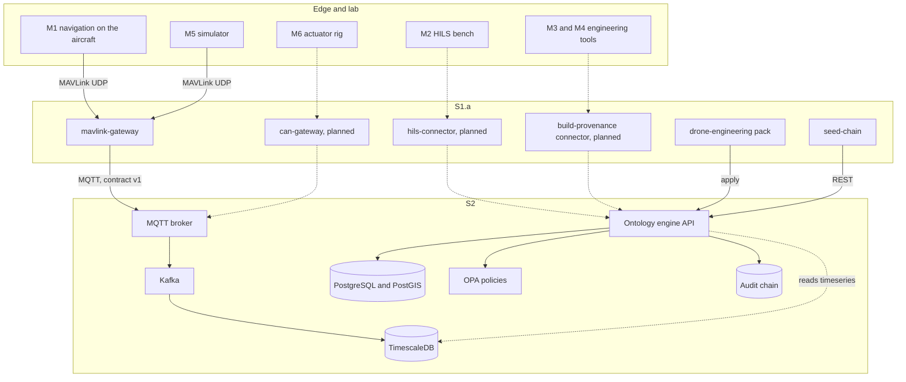
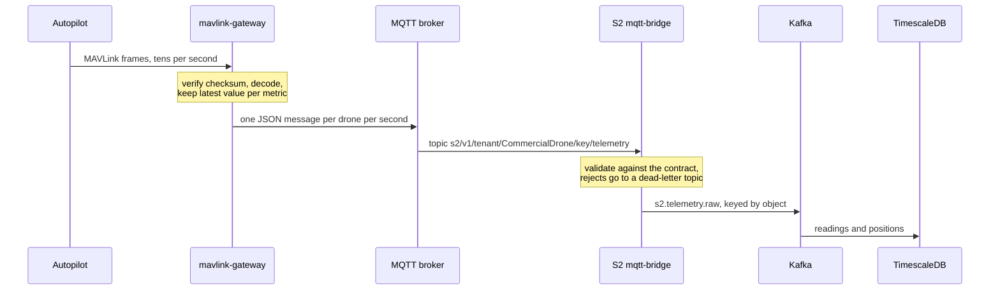
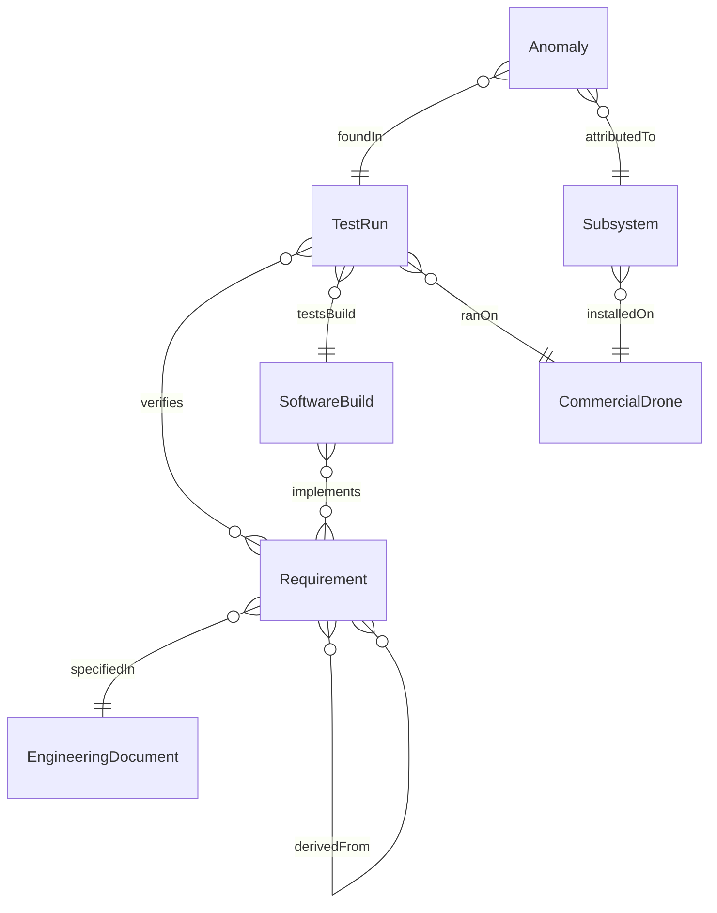

# Architecture

This document describes how S1.a is put together, how data moves through it, and where it stops and S2 begins. Parts that are planned and not yet built are marked.

## 1. Context

Project Samanvaya defines six product modules for a commercial drone company. Each produces data that the others need.

| Module | What it is | What it produces |
|---|---|---|
| M1 | Navigation without GNSS at night, on a Jetson-class computer | Flight datasets, position estimates, flight trial results |
| M2 | Anomaly detection on hardware-in-the-loop (HILS) benches | Pass/fail verdicts, anomaly windows, root-cause attributions |
| M3 | Generated aviation software documents (SRS, SDD, ICD, STP, STR) | Requirements and documents with traceability |
| M4 | Offline multi-agent software engineering platform | Source code, builds, unit and SITL test reports |
| M5 | Multi-drone simulator on real GIS terrain | Simulated missions and telemetry |
| M6 | Real-time visual twin of actuators and gimbals | Fault classifications |

S1.a is the integration layer. It does not implement the modules. It moves their outputs into S2 and defines the model they are stored in.

## 2. System view

## 3. Three loops at three speeds

The modules contain loops with very different timing. Only the slowest belongs inside S2.

| Loop | Latency budget | Runs on | Role of S1.a and S2 |
|---|---|---|---|
| Hard real-time: M1 position into the flight controller at 10 Hz or faster; M6 twin rendering within 20 ms | milliseconds | Aircraft computer, bench PC | None in the path. They receive a copy. |
| Soft real-time: fleet telemetry, bench alerts, operator screens | 0.1 to a few seconds | Lab network, MQTT, Kafka | S1.a gateways ingest; S2 stores and serves |
| Engineering: requirement, code, simulation, bench, flight clearance | minutes to weeks | S2 | S2 owns the state; S1.a defines the model |

**Design rule:** nothing in a control loop may wait on a gateway, the broker or S2. The MAVLink gateway enforces its half of this by being receive-only: it opens no path back to the vehicle.

## 4. Telemetry path

Inside the gateway:

| Package | Responsibility |
|---|---|
| `internal/mavlink` | Frame sync for MAVLink v1 and v2, X.25 checksum with per-message seed, zero-extension of truncated v2 payloads, decoders for seven messages |
| `internal/telemetry` | Per-vehicle state, unit conversion, mapping of system id to S2 object key, building contract messages |
| `internal/mqtt` | Minimal MQTT 3.1.1 publisher, QoS 0, reconnect |
| `cmd/mavlink-gateway` | Flags, UDP receive loop, publish ticker, counters |

Telemetry is keyed by the object's natural key (tenant, object type, primary key), not by an internal id. A drone that is not yet registered in the ontology still has its readings stored, and they appear on the object once it exists. This is S2's decision (its ADR 0008); the gateway relies on it.

## 5. The ontology

The `drone-engineering` pack requires S2's `core-fleet` pack, which supplies `CommercialDrone`.

| Object type | Key states | Written by |
|---|---|---|
| `Requirement` | DRAFT, APPROVED, SUPERSEDED | M3 |
| `EngineeringDocument` | DRAFT, IN_REVIEW, BASELINED, SUPERSEDED | M3 |
| `SoftwareBuild` | BUILT, SIM_PASSED, BENCH_PASSED, CLEARED_FOR_FLIGHT, REJECTED | M4, build pipeline |
| `TestRun` | SCHEDULED, RUNNING, COMPLETED, ABORTED; verdict PASS, FAIL, INCONCLUSIVE | M1, M2, M4, M5 |
| `Anomaly` | OPEN, CONFIRMED, DISMISSED, RESOLVED | M2, M6, operators |
| `Subsystem` | none | Fleet engineering |

Because the links form a closed chain, questions become graph walks: from a requirement to every test run that verifies it; from an anomaly back through its test run and build to the requirements at risk.

## 6. Governed actions

State that matters changes only through named actions. S2 validates the parameters, asks its policy engine, and writes the edit and the audit entry in one transaction.

| Action | Effect | Approval | Agents |
|---|---|---|---|
| `recordTestVerdict` | Closes a test run with a verdict | No | No |
| `raiseAnomaly` | Creates an anomaly linked to its test run | No | No |
| `attributeAnomaly` | Confirms an anomaly, links the subsystem, records root cause | No | No |
| `baselineDocument` | Marks a document revision as the baseline | Yes | May propose |
| `clearBuildForFlight` | Releases a build to fly | Yes, by a second person | No |
| `rejectBuild` | Marks a build as not to be used | No | No |

S2's baseline policy applies to all of them: requesting needs the `operator` role, approving needs the `approver` role, and the requester cannot approve their own request.

## 7. Deployment

| Component | Where it runs | Notes |
|---|---|---|
| mavlink-gateway | Ground station, bench PC, or beside the simulator | One static binary. One instance per MAVLink source network. |
| Ontology pack and seed | Applied once to an S2 engine | Idempotent; re-applying reports what changed. |
| S2 | On-premises, Docker Compose or Kubernetes with Helm | Module 4 requires zero internet dependency, so an offline install path for S2 is a requirement, not an option. It is not yet tested. |

## 8. Security boundaries

- The gateway is receive-only towards vehicles and write-only towards the broker.
- The tenant in the MQTT topic is only as trustworthy as the broker's access control. S2's local stack has none; production needs per-gateway credentials and topic ACLs.
- MAVLink 2 signatures are not verified. On an untrusted link, anyone who can send UDP to the gateway can inject telemetry.
- Flight software, datasets and trained models are proprietary to the operator. This repository holds the integration code and the generic model, not those assets.

## 9. Planned work

1. HILS connector: bench run metadata, verdicts and anomaly windows into `TestRun` and `Anomaly`.
2. Source-timestamped telemetry for bench use: PTP clock, per-signal rates above 1 Hz.
3. CAN gateway for bench buses.
4. Build-provenance connector from the offline CI pipeline.
5. Orchestrated build gate: simulation pass, bench pass, flight clearance.
